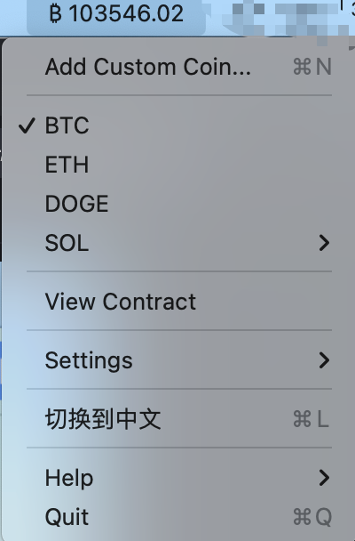

# BTC Watcher

[中文](README_CN.md) | English

A lightweight macOS menu bar application for real-time cryptocurrency price tracking.

[Live Page](https://chenchenwuai.github.io/btc-watcher/)



## Quick Start 🚀

### Option 1: Download Release
1. Go to [Releases](https://github.com/chenchenwuai/btc-watcher/releases) page
2. Download the latest `BTCWatcher.app.zip`
3. Unzip the application
4. Right-click the app and select "Open" (important for first launch)
5. Click "Open" in the security dialog
6. Drag to your Applications folder (optional)

Note: If you see "app is damaged" message:
1. Open Terminal
2. Run: `xattr -cr /Applications/BTCWatcher.app` (adjust path if needed)
3. Try opening the app again

### Option 2: Build from Source
If you prefer to build from source:
```bash
git clone https://github.com/chenchenwuai/btc-watcher.git
cd btc-watcher
./build.sh
```

The script will:
- Compile the Swift code
- Create the app bundle
- Package it into a zip file
- Set all necessary permissions

## Features

- 🚀 Lightweight menu bar app
- 💰 Live watchlist for BTC, ETH, DOGE, and custom pairs
- ➕ Custom coin pair addition
- 🔄 Real-time price updates (1s, 2s, 5s intervals)
- 📊 Base price tracking with percentage change display
- 📈 Single-form position editing with a notional value preview, PnL, and ROI
- 🧩 Configurable menu bar display fields for compact screens
- 🌐 Spot/Futures trading mode switch
- 🔌 SOCKS5 proxy support (ClashX compatible)
- 🌍 English and Chinese language support
- 🔗 Quick access to Binance futures
- 🔔 Check for and install updates from the app

## System Requirements

- macOS 13.0 or later
- Internet connection required for price updates

## Usage

### Basic Operations
- Click the menu bar icon to view all watched prices. The menu marks cached prices as stale when refresh fails.
- Open a coin's submenu and choose **Show in Menu Bar** to pin its price.
- Open **Settings → Help → Check for Updates…** to check for a new version. Release builds can install it in-app, and standard local builds link to the download page. Install the first release that supports in-app installation manually.
- Use `⌘Q` to quit

### Customization
- Update Intervals: Choose between 1, 2, or 5 seconds
- Trading Mode: Switch between Spot and Futures
- API Endpoints: Auto or manual selection
- Proxy Settings: Configure SOCKS5 proxy (default port 7890 for ClashX)
- Position Tracking: Choose **Edit Position…** in a coin's submenu to set the entry price, direction, margin or quantity, and leverage and preview the notional value. Leave the amount blank to track change against the entry price alone.
- Menu Bar Display: Toggle price, entry change, unrealized PnL, and ROI fields
- Price Trend: In **Settings → Menu Bar**, choose **Live 5m**, **15m**, **1h**, or **4h**. The historical options plot the last 30 Binance candles for the selected pair, with the current quote updating the open candle.
- Language: Switch between English and Chinese
- Custom Pairs: Add your own trading pairs

### Keyboard Shortcuts
- `⌘N`: Add custom coin
- `1`: Set 1-second update interval
- `2`: Set 2-second update interval
- `5`: Set 5-second update interval
- `A`: Toggle API auto-switch
- `L`: Switch language
- `⌘Q`: Quit application

## Development

### Building from Source
```bash
# Compile the application
./build.sh

# Generate application icons
./generate_icons.sh
```

### Building with in-app updates

Download and extract the [Sparkle distribution used by the release workflow](https://github.com/sparkle-project/Sparkle/releases/tag/2.10.1). Set `SPARKLE_DIR` to that directory and use its `bin/generate_keys --account btcwatcher` command to create a signing key in your macOS Keychain. Then build with Sparkle enabled.

```bash
SPARKLE_PUBLIC_KEY=$("$SPARKLE_DIR/bin/generate_keys" --account btcwatcher -p)
SPARKLE_DIR="$SPARKLE_DIR" SPARKLE_PUBLIC_KEY="$SPARKLE_PUBLIC_KEY" ./build.sh
```

In GitHub Actions, set the repository variable `SPARKLE_PUBLIC_KEY` to the public key and the repository secret `SPARKLE_PRIVATE_KEY` to its matching private key, exported with `bin/generate_keys --account btcwatcher -x <private-key-file>`. Keep a secure backup of the private key and reuse it for future releases. Increment `CFBundleVersion` for each release. The tag workflow signs the ZIP and appcast, then publishes both assets together. Running `./build.sh` without Sparkle configuration checks GitHub for new releases and opens the release page for manual installation.

### Project Structure
- `Sources/BTCMenuBar/App/`: Application entry point, lifecycle, and settings storage
- `Sources/BTCMenuBar/MenuBar/`: Menu construction, menu actions, and manual position settings
- `Sources/BTCMenuBar/BinanceAccount/`: Account credentials, open-order queries, and position sync
- `Sources/BTCMenuBar/MarketData/`: Price fetching, API switching, and proxy session setup
- `Sources/BTCMenuBar/Shared/`: Shared models, formatting, and localized strings
- `AppIcon.svg`: Application icon source
- `generate_icons.sh`: Icon generation script
- `Info.plist`: Application configuration

## Data Source

Price data is fetched from Binance API through multiple endpoints:

**Spot Mode:**
- api.binance.com
- api1-4.binance.com

**Futures Mode:**
- fapi.binance.com
- fapi1-4.binance.com

## Technical Details

### Implementation
- Built with native macOS frameworks (Cocoa, Foundation)
- Sparkle handles in-app updates in release builds
- Efficient menu bar integration using NSStatusItem
- Automatic error handling and API failover
- Dynamic menu generation
- Real-time price formatting

### Price Display
- Intelligent decimal place handling
- Unicode symbols for cryptocurrencies (₿, Ξ, Ð)
- Clean and minimal interface

### Error Handling
- Automatic API endpoint switching
- Connection error recovery
- User-friendly error messages
- Graceful degradation

## Security

- Market quotes use public Binance endpoints. Open orders and futures position sync use authenticated, read-only requests.
- Minimal system permissions required
- Binance credentials are stored in the macOS Keychain. The secret key signs requests locally.
- The app bundle uses macOS ad-hoc signing, and Sparkle verifies the signatures of the update feed and download.

## Contributing

Contributions are welcome! Feel free to:
- Report bugs
- Suggest features
- Submit pull requests
- Improve documentation

## License

MIT License

## Author

chenwuai

## Support

For issues, questions, or suggestions:
1. Open an issue
2. Submit a pull request
3. Contact the developer

---

*Note: This application is not affiliated with Binance or any cryptocurrency exchange.*
