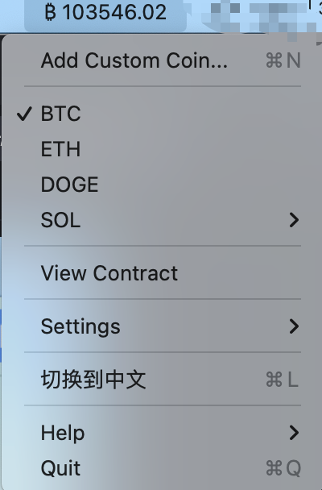

# BTC Watcher

[English](README.md) | 中文

一个轻量级的 macOS 菜单栏应用，用于实时追踪加密货币价格。

[在线页面](https://chenchenwuai.github.io/btc-watcher/)



## 快速开始 🚀

### 方式一：下载发布版
1. 访问 [Releases](https://github.com/chenchenwuai/btc-watcher/releases) 页面
2. 下载最新的 `BTCWatcher.app.zip`
3. 解压应用
4. 右键点击应用，选择"打开"（首次启动时很重要）
5. 在安全性对话框中点击"打开"
6. 拖入应用程序文件夹（可选）

注意：如果遇到"应用程序已损坏"的提示：
1. 打开终端
2. 运行：`xattr -cr /Applications/BTCWatcher.app`（根据实际路径调整）
3. 重新尝试打开应用

### 方式二：从源码编译
如果你想自己编译：
```bash
git clone https://github.com/chenchenwuai/btc-watcher.git
cd btc-watcher
./build.sh
```

脚本会自动：
- 编译 Swift 代码
- 创建应用程序包
- 打包成 zip 文件
- 设置所有必要的权限

## 功能特点

- 🚀 轻量级菜单栏应用
- 💰 在下拉菜单同时查看 BTC、ETH、DOGE 和自定义交易对的行情
- ➕ 自定义交易对添加
- 🔄 实时价格更新 (1秒、2秒、5秒间隔)
- 📊 基准价设置与涨跌幅显示
- 📈 在同一个表单编辑仓位，预览名义价值，追踪未实现盈亏和 ROI
- 🧩 菜单栏显示字段可配置，适配小屏幕
- 🌐 现货/合约交易模式切换
- 🔌 SOCKS5 代理支持（兼容 ClashX）
- 🌍 中英文双语支持
- 🔗 快速跳转币安合约
- 🎯 零依赖，纯 Swift 实现

## 系统要求

- macOS 13.0 或更高版本
- 需要网络连接以获取价格更新

## 安装方法

1. 下载最新版本的 `BTCWatcher.app`
2. 将应用拖入应用程序文件夹
3. 双击启动应用
4. 如果出现安全提示，请在系统设置 > 安全性与隐私中允许应用运行

## 使用说明

### 基本操作
- 点击菜单栏图标查看所有自选交易对报价。刷新失败时，缓存价格会标记为旧报价。
- 在币种子菜单选择 **在菜单栏显示**，切换菜单栏展示的交易对。
- 使用 `⌘Q` 退出应用

### 自定义设置
- 更新频率：可选 1秒、2秒或 5秒
- 交易模式：切换现货/合约模式
- API 接口：自动或手动选择
- 代理设置：配置 SOCKS5 代理（默认端口 7890，适配 ClashX）
- 持仓追踪：从币种子菜单打开 **编辑仓位…**，填写开仓价、方向、保证金或数量及杠杆，并预览名义价值。仓位金额或数量留空时，可单独追踪相对开仓价的变化。
- 菜单栏显示：可开关价格、相对开仓价变化、未实现盈亏和 ROI 字段
- 价格走势：在「菜单栏显示 → 价格走势」中选择「实时 5m」「15m」「1h」或「4h」。历史周期显示当前交易对最近 30 根币安 K 线的收盘价，并用实时报价更新尚未收盘的一根。
- 语言：切换中英文界面
- 自定义：添加自定义交易对

### 快捷键
- `⌘N`：添加自定义币种
- `1`：设置 1 秒更新频率
- `2`：设置 2 秒更新频率
- `5`：设置 5 秒更新频率
- `A`：切换 API 自动模式
- `L`：切换语言
- `⌘Q`：退出应用

## 开发相关

### 从源码编译
```bash
# 编译应用
./build.sh

# 生成应用图标
./generate_icons.sh
```

### 项目结构
- `Sources/BTCMenuBar/App/` 保存应用入口、生命周期和设置读写代码。
- `Sources/BTCMenuBar/MenuBar/` 保存菜单构建、菜单操作和手动仓位设置代码。
- `Sources/BTCMenuBar/BinanceAccount/` 保存账户凭证、挂单查询和持仓同步代码。
- `Sources/BTCMenuBar/MarketData/` 保存行情请求、API 切换和代理会话配置代码。
- `Sources/BTCMenuBar/Shared/` 保存共享模型、格式化逻辑和多语言文案。
- `AppIcon.svg`：应用图标源文件
- `generate_icons.sh`：图标生成脚本
- `Info.plist`：应用配置文件

## 数据来源

价格数据通过以下 Binance API 接口获取：

**现货模式：**
- api.binance.com
- api1-4.binance.com

**合约模式：**
- fapi.binance.com
- fapi1-4.binance.com

## 技术细节

### 实现方式
- 使用原生 macOS 框架（Cocoa、Foundation）
- 无外部依赖
- 使用 NSStatusItem 实现菜单栏集成
- 自动错误处理和 API 故障转移
- 动态菜单生成
- 实时价格格式化

### 价格显示
- 智能小数位处理
- 使用 Unicode 符号表示加密货币（₿、Ξ、Ð）
- 简洁清晰的界面

### 错误处理
- 自动切换 API 接口
- 连接错误恢复
- 友好的错误提示
- 优雅的降级处理

## 安全性

- 仅使用公开 API 接口
- 最小系统权限要求
- 不存储敏感数据
- 经过 macOS 安全签名

## 参与贡献

欢迎参与贡献！你可以：
- 报告问题
- 提出新功能建议
- 提交代码
- 改进文档

## 开源协议

MIT 协议

## 作者

chenwuai

## 支持

如有问题或建议：
1. 提交 Issue
2. 提交 Pull Request
3. 联系开发者

---

*注意：本应用与币安或任何加密货币交易所均无关联。*
